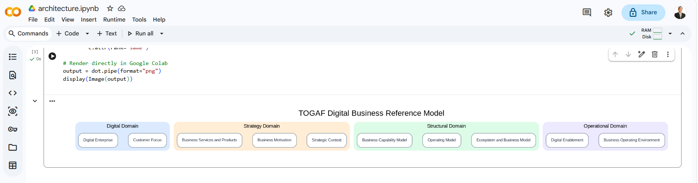
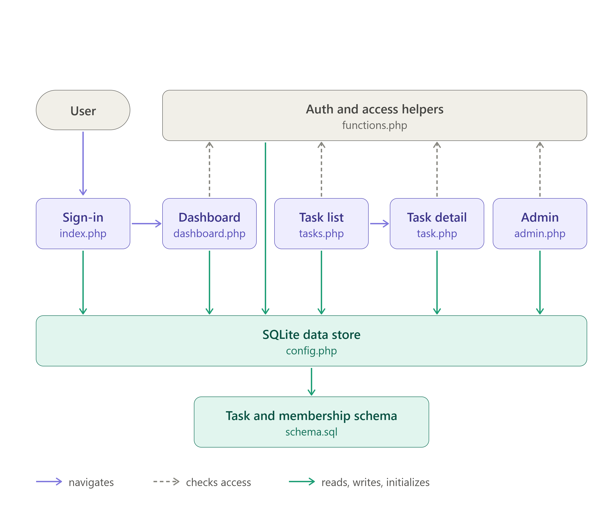
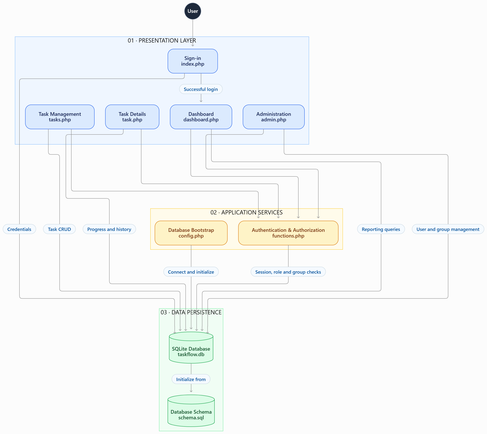

# Archimate

Archimate is the name of my first GitHub repository, which I made somewhere around 20 December 2016, somewhere in the UK, sometime during my PhD years. The idea is very simple: how can I describe the interrelation between applications, assets, code, and concepts? However, I was not able to actualize it until maybe now, 15 November 2026, almost 10 years later. This is after passing ARIS certification in 2017, doing banks' IT Architecture since 2019, passing TOGAF certification in 2021, and even working as an IT Architect in 2023. But now, finally, I can make this happen.

I also make this for Architecture TaskFlow, but right now on progress, this is similar with GitDiagram.com. The name of Archimate is of course the name of the Architecture Tools.

Below is the code. You can run it directly with Google Colab:

[Open in Google Colab](https://colab.research.google.com/github/priandoyo/archimate/blob/master/architecture.ipynb)

[GitHub Repository](https://github.com/priandoyo/archimate)

---

## Example: TOGAF Digital Business Reference Model (DBRM)

This is one example to create (visualize) the architecture of the TOGAF Digital Business Reference Model (DBRM).

The DBRM consists of ten core elements categorized into four domains as follows:

**Digital Domain:**
- Customer Focus
- Digital Enterprise

**Strategy Domain:**
- Strategic Context
- Business Motivation
- Business Services and Products

**Structural Domain:**
- Ecosystem and Business Model
- Operating Model
- Business Capability Model

**Operational Domain:**
- Business Operating Environment
- Digital Enablement

---

## Reference Images

### TaskFlow Architecture

### Mermaid Diagram

